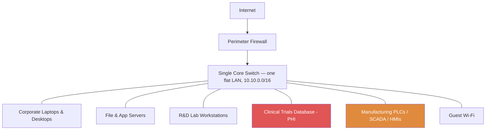
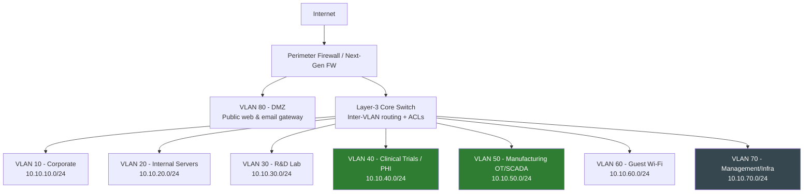

# 02 — Network Architecture & Segmentation

## In plain terms

Imagine an office building with no interior walls or locked doors — anyone who gets in the front door can walk into the CEO's office, the server room, or the factory floor. That's what a **flat network** is: every device (a laptop in Finance, a server holding patient data, a factory machine) sits on the same network, able to talk to every other device.

**Network segmentation** is the equivalent of adding interior walls, locked doors, and a front-desk sign-in sheet: it splits the network into zones (VLANs) based on *what that zone contains and how sensitive it is*, and only allows the specific, necessary traffic between zones. The payoff: if an attacker compromises one laptop in Finance, they hit a locked door before they can reach the factory's manufacturing systems or the clinical trial database — instead of a wide-open hallway.

## Before: VitalCore's original flat network

**The problem:** everything above sits behind one switch with no internal boundaries. A phishing email opened on a Corporate laptop (A) can, in principle, reach the Clinical Trials database (D) or the Manufacturing control systems (E) directly — the two most sensitive and dangerous things to lose control of in this company.

## After: Segmented, Zero-Trust-aligned network

**The fix:** every zone above only exists behind the Layer-3 core switch's Access Control Lists (ACLs) — meaning a device in one VLAN cannot reach a device in another VLAN unless there's an explicit rule allowing it (see the [firewall rule matrix](firewall-rules/inter-vlan-acl-matrix.md)). Guest Wi-Fi (VLAN 60) can reach the internet and nothing else. Manufacturing (VLAN 50) and Clinical Trials (VLAN 40) — the two most sensitive zones — are isolated from every other zone except the narrow, specific connections they actually need.

## VLAN design table

| VLAN | Name | Subnet | Who/what lives here | Sensitivity |
|---|---|---|---|---|
| 10 | Corporate | 10.10.10.0/24 | Employee laptops/desktops (Finance, HR, Legal, Sales) | Confidential |
| 20 | Internal Servers | 10.10.20.0/24 | File servers, internal business apps, print servers | Confidential |
| 30 | R&D Lab | 10.10.30.0/24 | Research workstations, lab instruments | Restricted |
| 40 | Clinical Trials | 10.10.40.0/24 | Patient trial database & applications (PHI, HIPAA scope) | Restricted |
| 50 | Manufacturing OT | 10.10.50.0/24 | PLCs, SCADA, HMIs on production lines | Restricted |
| 60 | Guest Wi-Fi | 10.10.60.0/24 | Visitor devices | Public |
| 70 | Management/Infra | 10.10.70.0/24 | Switch/firewall/AP management interfaces | Restricted |
| 80 | DMZ | 10.10.80.0/24 | Public-facing web server, email gateway | Confidential |

**Why these specific splits?** Each VLAN groups devices that share the same *sensitivity level* and *communication needs*. Manufacturing (50) and Clinical Trials (40) are each given their own VLAN — not lumped in with "servers" generally — because they're independently regulated (GxP and HIPAA respectively) and have almost nothing legitimate to say to each other. Management (70) is isolated so that even if an attacker compromises a regular user device, they cannot reach the switches' and firewall's own admin interfaces.

## How inter-VLAN traffic is controlled

Full rule set: [firewall-rules/inter-vlan-acl-matrix.md](firewall-rules/inter-vlan-acl-matrix.md)
Sample firewall rule syntax: [firewall-rules/pfsense-rules.md](firewall-rules/pfsense-rules.md)

The guiding principle is **default-deny**: every VLAN is blocked from every other VLAN unless a rule explicitly allows a specific, necessary connection (e.g., "Corporate can reach Internal Servers on port 443 for the intranet app" — but Corporate cannot reach Manufacturing at all, on any port).

## Additional segmentation techniques used

- **DMZ isolation:** anything reachable from the public internet (VLAN 80) sits in its own zone, physically unable to initiate connections into any internal VLAN.
- **OT/IT boundary:** Manufacturing (VLAN 50) has no direct route to the internet at all — patches and updates for these systems go through a controlled jump host, not a live internet connection, which is standard practice for industrial control systems.
- **Micro-segmentation within Clinical Trials:** the trial database server and the trial web application are placed in separate sub-zones within VLAN 40, so that even a compromise of the front-end web app doesn't grant direct database access.

---
**Previous:** [← 01 — Company Profile & Scope](../01-company-profile-and-scope/README.md)
**Next:** [03 — NIST CSF Implementation →](../03-nist-csf-implementation/README.md)
