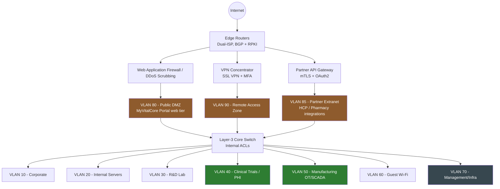

# 08 — Internal & External Network Protocols and Segmentation

## In plain terms

[Section 02](../02-network-architecture-and-segmentation/README.md) segmented VitalCore's *internal* network into zones like Corporate, R&D, Clinical, and Manufacturing. But once VitalCore added **MyVitalCore Portal** — a public website and mobile app used by 100,000+ patients, physicians, and pharmacy partners (see [Section 01](../01-company-profile-and-scope/README.md#digital-footprint--organizational-scale)) — a new question appeared: *what protects the network from the internet side, and what protects internal systems from that public-facing side?*

This section extends the segmentation model to cover that boundary explicitly: which network protocols are used where, and how "internal-only" traffic is kept structurally separate from "faces the public internet" traffic — because those two categories of risk need very different rules.

## Expanded zone model: internal vs. external

**The key idea:** none of the three new external-facing zones (Public DMZ, Partner Extranet, Remote Access) connect directly to any internal VLAN. All traffic still passes through the Layer-3 core switch's ACLs — the same default-deny model from [Section 02](../02-network-architecture-and-segmentation/README.md) — so a compromise of the internet-facing portal doesn't automatically mean a compromise of Clinical Trials or Manufacturing.

## New zones explained

| Zone | Purpose | Who/what connects here |
|---|---|---|
| **Public DMZ (VLAN 80)** | Hosts the public web/API tier of MyVitalCore Portal | The general public internet (100,000+ patients, physicians, pharmacy users) |
| **Partner Extranet (VLAN 85)** | Machine-to-machine integration with external partner systems | Referring physician EHR systems, pharmacy inventory systems |
| **Remote Access Zone (VLAN 90)** | Staff connecting from outside VitalCore's physical sites | The ~50-person distributed IT/Security team, traveling employees |

## Internal network protocols

These protocols only exist between trusted, internal VitalCore-owned systems and are never exposed to the internet directly.

| Protocol | Used for | Why this choice |
|---|---|---|
| **802.1X** | Port-based network access control on wired switches and Wi-Fi | A device (or person) must authenticate before it's even placed on a VLAN — prevents an unauthorized laptop plugged into an office jack from reaching anything |
| **Kerberos + LDAPS** | Active Directory authentication | Kerberos avoids sending passwords over the network; LDAPS encrypts directory lookups (replacing unencrypted LDAP) |
| **IPsec site-to-site VPN** | Encrypts traffic between VitalCore's physical sites (HQ, R&D, Manufacturing, Clinical Data Center) over shared WAN links | Ensures inter-site traffic is confidential even if it transits a third-party carrier network |
| **SNMPv3** | Monitoring switches, firewalls, and infrastructure health | Version 3 specifically — adds authentication and encryption that SNMPv1/v2c lack, preventing infrastructure monitoring data (and control) from being intercepted or spoofed |
| **Authenticated NTP** | Time synchronization across all systems | Accurate, tamper-resistant timestamps are essential for correlating logs during an investigation (see [Section 11](../11-siem-soar-implementation/README.md)) — without this, SIEM correlation across systems becomes unreliable |
| **Syslog over TLS** | Forwarding logs from devices to the central SIEM | Encrypts log data in transit and prevents an attacker from injecting or spoofing log entries to cover their tracks |
| **DHCP snooping + Dynamic ARP Inspection** | Prevents rogue DHCP servers and ARP spoofing/man-in-the-middle attacks on internal VLANs | Standard hardening for any switched network handling sensitive traffic (Clinical, Manufacturing especially) |

## External-facing / perimeter protocols

These protocols govern traffic that touches the public internet or external partner networks.

| Protocol | Used for | Why this choice |
|---|---|---|
| **TLS 1.3 (minimum TLS 1.2)** | All MyVitalCore Portal and partner API traffic | Older protocols (SSL, TLS 1.0/1.1) are deprecated and vulnerable; enforcing 1.2+ (preferring 1.3) is a baseline expectation for any system handling PHI-adjacent data |
| **HSTS (HTTP Strict Transport Security)** | Forces browsers to only ever connect to the portal over HTTPS | Prevents downgrade attacks that trick a user's browser into connecting over plain HTTP |
| **DNSSEC** | Cryptographically signs VitalCore's public DNS records | Prevents DNS spoofing/cache poisoning attacks that could redirect patients to a fake portal |
| **mTLS (mutual TLS) + OAuth2** | Partner API Gateway authentication for physician/pharmacy system integrations | Both sides prove their identity with certificates (mTLS), and OAuth2 scopes limit exactly what data each partner integration can request — a pharmacy partner's integration cannot query clinical trial results, for example |
| **SSL VPN + MFA** | Remote staff access | Every remote connection requires a second factor, and lands users in the isolated Remote Access zone (VLAN 90) — not directly on the internal network |
| **BGP with RPKI** | Internet edge routing across dual ISPs | Provides redundancy (if one ISP fails, traffic reroutes) and RPKI validates that route announcements are legitimate, protecting against BGP hijacking — appropriate given the portal now needs to stay available for 100,000+ external users |
| **Web Application Firewall (WAF) + DDoS scrubbing** | Filters malicious traffic (SQL injection, XSS, volumetric attacks) before it reaches the portal | At this scale of public exposure, the portal is a realistic target for both opportunistic attacks and deliberate DDoS — the WAF/scrubbing layer sits in front of the DMZ, not behind it |

## How internal and external rules interact

The [inter-VLAN ACL matrix](../02-network-architecture-and-segmentation/firewall-rules/inter-vlan-acl-matrix.md) is extended with the same default-deny logic for the three new zones:

- **Public DMZ (80) → Internal Servers (20):** allowed only on the single port needed for the portal's application server to query a specific, narrowly-scoped internal API — never a direct database connection, and never to Clinical (40) or Manufacturing (50) at all.
- **Partner Extranet (85) → anything internal:** allowed only through the API Gateway, which enforces OAuth2 scopes per partner — a pharmacy integration's credentials simply do not have a scope that includes clinical data, regardless of network reachability.
- **Remote Access (90) → internal VLANs:** a remote user lands in VLAN 90 and is then subject to the *exact same* [RBAC](../04-least-privilege-and-access-control/rbac-roles-matrix.md) rules as if they were sitting in the office — remote access changes *how* someone connects, never *what* they're allowed to touch.

## Why this section exists separately from Section 02

Section 02 solved "how do we stop internal lateral movement." This section solves a different problem: "how do we let 100,000+ people who are *not* VitalCore employees reach exactly one narrow set of systems, safely, without that access ever becoming a bridge into the internal network." Both problems use the same underlying default-deny philosophy, but the external-facing controls (WAF, mTLS, DDoS protection, DNSSEC) are a distinct layer that a purely internal segmentation design doesn't need.

---
**Previous:** [← 07 — HIPAA Compliance Framework](../07-hipaa-compliance-framework/README.md)
**Next:** [09 — CSIRT & Incident Response →](../09-csirt-and-incident-response/README.md)
