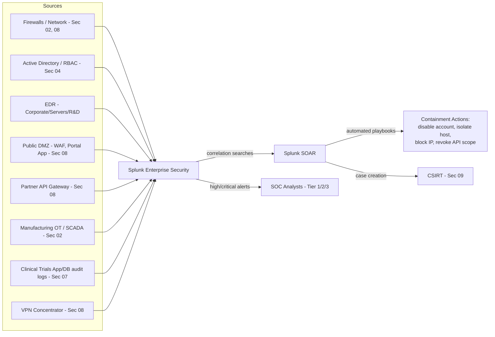

# 11 — SIEM & SOAR Implementation

## In plain terms

Every control built in this project so far — segmentation, least privilege, CSIRT — generates logs and alerts *somewhere*. A **SIEM (Security Information and Event Management)** platform is the central place that collects all of it, so a security analyst isn't checking a firewall in one tab, Active Directory in another, and the portal's web server logs in a third. A **SOAR (Security Orchestration, Automation, and Response)** platform goes one step further: for well-understood, repetitive alert types, it automates the first response steps instead of waiting for a human to manually do them every time. At VitalCore's scale — 100,000+ portal users, 50+ IT/Security staff, and systems spanning Corporate, R&D, Clinical, Manufacturing, and the external zones from [Section 08](../08-network-protocols-and-segmentation/README.md) — manually correlating logs by hand simply doesn't scale; this section is the platform that makes every earlier "Detect" and "Respond" control from [Section 03](../03-nist-csf-implementation/README.md) actually operable day-to-day.

## Platform choice

| Platform | Tool selected | Why |
|---|---|---|
| **SIEM** | Splunk Enterprise Security | Mature correlation search engine, strong support for the wide variety of log formats VitalCore has (OT/SCADA syslog, cloud-hosted portal logs, on-prem AD, network devices), and scales to the ingest volume estimated below |
| **SOAR** | Splunk SOAR (integrates natively with Splunk ES) | Native integration avoids building custom connectors between separate SIEM/SOAR vendors, and supports the playbook automation described in [detection-and-playbooks.md](detection-and-playbooks.md) |

*(Architecturally, the same design would translate to Microsoft Sentinel + Sentinel Playbooks/Logic Apps, or Elastic Security + Elastic SOAR — Splunk is used here as the concrete worked example.)*

## Architecture

Full log source detail: [log-source-onboarding.md](log-source-onboarding.md)
Correlation rules and automated playbooks: [detection-and-playbooks.md](detection-and-playbooks.md)
Team structure running this platform: [soc-staffing-and-metrics.md](soc-staffing-and-metrics.md)

## Sizing for 100,000+ users / 50+ staff

Capacity planning matters here — under-sizing a SIEM means dropped logs (a blind spot exactly when you need visibility), and over-sizing wastes budget that could fund analyst headcount instead.

| Factor | Estimate | Why it matters |
|---|---|---|
| Portal authentication events (100K+ users) | ~2–4 million events/day | Login, MFA challenge, session activity from MyVitalCore Portal — the single largest volume source |
| Internal endpoint/EDR telemetry (50+ staff + ~1,200 employees' devices) | ~15–20 GB/day | Process execution, file, and network telemetry from EDR agents |
| Network/firewall logs (all VLANs incl. external zones) | ~10–15 GB/day | Every permit/deny decision across the [ACL matrix](../02-network-architecture-and-segmentation/firewall-rules/inter-vlan-acl-matrix.md) |
| Manufacturing OT/SCADA logs | Low volume, high sensitivity | Small in bytes but every event is reviewed with elevated priority given GxP/safety relevance |
| Partner API Gateway logs | ~1–2 GB/day | Every partner integration call, tagged by OAuth2 scope used |
| **Estimated total ingest** | **~50–75 GB/day** | Used to size Splunk indexer storage and license capacity |
| **Retention** | 90 days hot/searchable, 1 year warm, **6 years cold archive for anything touching Clinical/PHI systems** | The 6-year figure aligns with HIPAA's documentation retention expectations (see [Section 07](../07-hipaa-compliance-framework/README.md)) |

## Dashboards

| Dashboard | Audience | Shows |
|---|---|---|
| **Executive Security Posture** | CISO, leadership | Open incidents by severity, MTTD/MTTR trend, compliance-relevant metrics (e.g., access review completion) |
| **SOC Operations** | SOC analysts (Tier 1–3) | Live alert queue, correlation search health, case backlog |
| **External-Facing Health** | External Response Coordinator, Communications | Portal availability, WAF block rate, API Gateway error rate — the operational picture behind [Section 10](../10-security-plans-and-response/README.md)'s external monitoring program |
| **Manufacturing/OT Watch** | Manufacturing OT Owner | OT-specific alerts only — deliberately isolated so this sensitive audience isn't wading through unrelated Corporate noise |

## How this closes the loop on earlier sections

- Every alert threshold defined conceptually in [detect.md](../03-nist-csf-implementation/detect.md) is implemented here as an actual Splunk correlation search (see [detection-and-playbooks.md](detection-and-playbooks.md)).
- Every SOAR playbook's automated containment action (disable account, isolate VLAN port, revoke API scope) is what makes the "Contain" step timings promised in the [Internal](../09-csirt-and-incident-response/internal-incident-response-plan.md) and [External](../09-csirt-and-incident-response/external-incident-response-plan.md) incident response plans actually achievable within their stated targets.

---
**Previous:** [← 10 — Security Plans & Response](../10-security-plans-and-response/README.md)
**Back to:** [Main README](../README.md)
